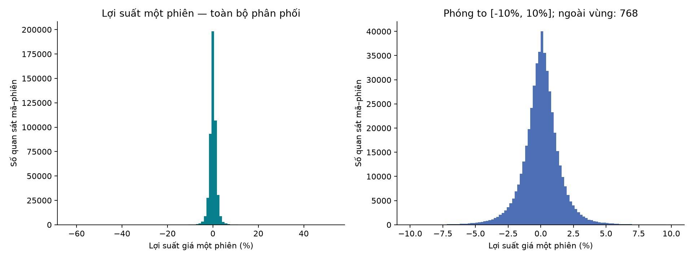
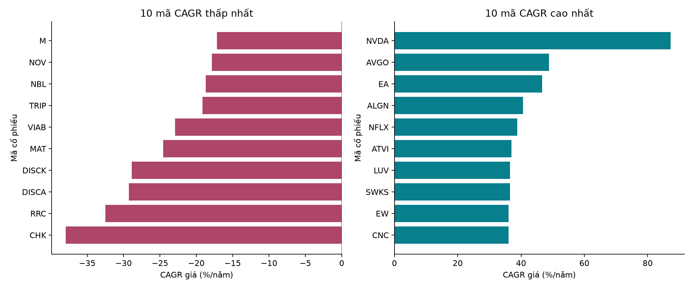
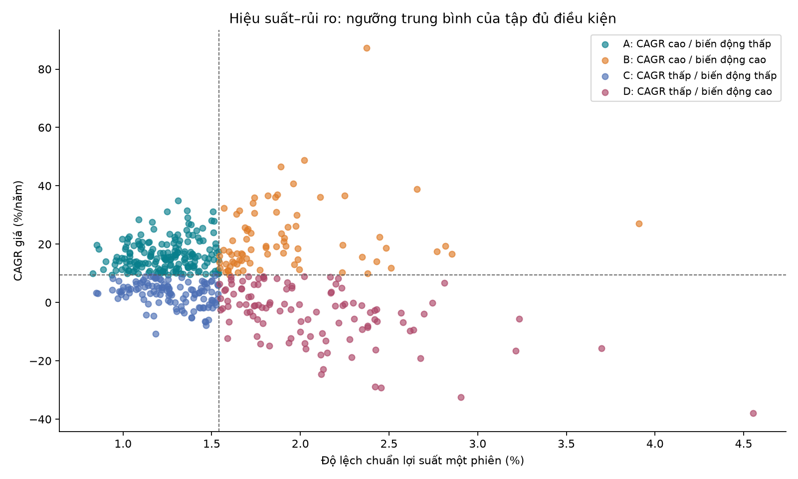
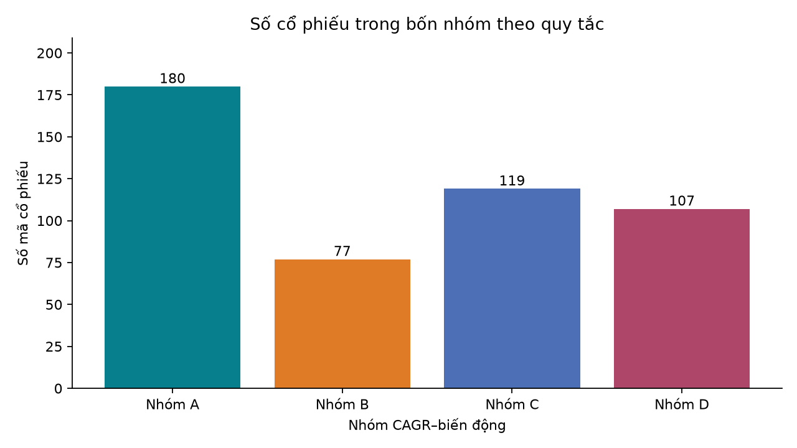
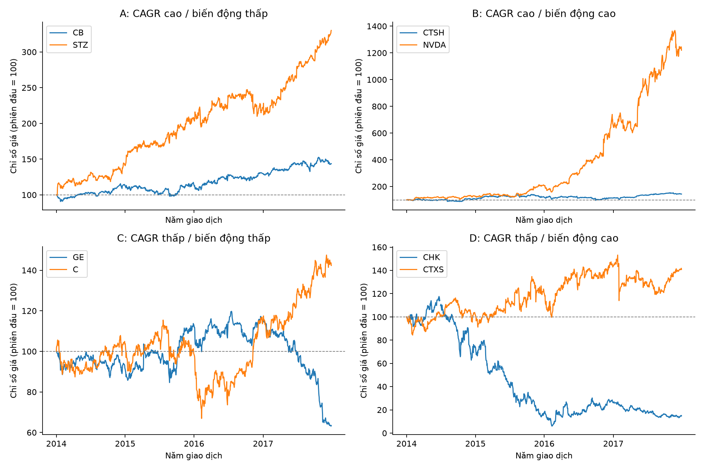

# Phân tích lợi suất và rủi ro cổ phiếu S&P 500 (2014–2017)

Báo cáo được sinh từ lần chạy script trên CSV cục bộ. Phạm vi: phân tích và phân nhóm; không có học máy.

## 1. Nhập dữ liệu và kiểm toán chất lượng (chương 6–9)

**Câu hỏi:** Dữ liệu có đủ chất lượng để so sánh biến động giá lịch sử không?

Tệp gốc có **497,472 dòng**, **505 mã**; lịch quan sát có **1,007 ngày**, từ **2014-01-02** đến **2017-12-29**. Schema: symbol, date, open, high, low, close, volume.

Các kiểm tra có phát hiện (số dòng có thể chồng lấn):

| Kiểm tra | Số dòng |
| --- | --- |
| missing_open | 11 |
| nonfinite_open | 11 |
| missing_high | 8 |
| nonfinite_high | 8 |
| missing_low | 8 |
| nonfinite_low | 8 |
| inconsistent_ohlc | 12 |

Sổ xử lý tuần tự, mỗi dòng bị loại chỉ được đếm một lần:

| Bước | Loại trong bước | Còn lại |
| --- | --- | --- |
| raw | 0 | 497472 |
| exact_duplicate | 0 | 497472 |
| missing_key | 0 | 497472 |
| conflicting_key | 0 | 497472 |
| invalid_close | 0 | 497472 |
| inconsistent_ohlc | 12 | 497460 |

Giữ **497,460 dòng** cho phân tích close. Có **11 dòng** trong số này không đủ OHLCV; không dùng chúng cho phép tính cần OHL/volume. Không điền giá thiếu bằng 0. Trùng hoàn toàn giữ dòng đầu; khóa trùng khác dữ liệu bị cách ly. OHLC mâu thuẫn bị cách ly vì không xác định được giá nào sai. Dòng bị loại và lý do được giữ trong `tables/excluded_rows.csv`.

Có **20 lợi suất qua khoảng thiếu phiên**: lưu riêng ở observed_return, không coi là daily_return. Có **85 biến động quan sát |return| ≥ 20%** được gắn cờ, **không tự xóa**; xem `tables/extreme_returns_review.csv`. Cờ này không chứng minh một sự kiện chia tách cổ phiếu.

## 2. Biến đổi và công thức (chương 4–5, 10–11)

**Câu hỏi:** Đo hiệu suất và rủi ro trên cùng cơ sở như thế nào?

- Lợi suất một phiên: `close_t / close_(t-1) - 1`, chỉ khi hai quan sát thuộc hai phiên liền kề trong lịch dataset và cùng mã.
- Lợi suất giá tích lũy: `close_t / close_0 - 1`; chỉ số chuẩn hóa: `100 * close_t / close_0`.
- Lợi suất ngày trung bình: trung bình các daily_return hợp lệ.
- Daily volatility: NumPy `std()` với ddof=0, độ lệch chuẩn tổng thể mô tả mẫu quan sát, không thường niên hóa.
- CAGR giá: `(close_end / close_start) ** (1 / Y) - 1`, `Y = số ngày lịch / 365.25`.

So sánh chung từ 2014-01-02 đến 2017-12-29; cần đủ hai đầu mút, ít nhất 95% phiên có close hợp lệ và 95% cặp phiên liên tiếp có return. Có **483 mã đạt**, **22 mã không đạt**. Các mã không đạt vẫn có bảng chỉ tiêu theo kỳ riêng nhưng không tham gia xếp hạng/phân nhóm. Lịch tham chiếu là hợp các ngày quan sát, không phải lịch sàn được kiểm chứng độc lập.

## 3. Phân phối và xếp hạng hiệu suất (chương 12–13)

**Câu hỏi:** Lợi suất phân bố ra sao, mã nào nổi bật trong kỳ chung?

Hình trái giữ toàn bộ phân phối; hình phải chỉ phóng to vùng ±10%, ghi số quan sát ngoài vùng. Các mã–phiên có thể phụ thuộc lẫn nhau; đây không phải mẫu các quan sát độc lập hay bằng chứng lợi suất tương lai.

Trong tập đủ điều kiện, **NVDA** có CAGR cao nhất (87.21%/năm), **CHK** có CAGR thấp nhất (-37.98%/năm). CAGR đo hai đầu kỳ và không mô tả đường đi; cần đọc cùng volatility và đường giá chuẩn hóa.

## 4. Bốn nhóm theo quy tắc

**Câu hỏi:** Các mã khác nhau thế nào về kết hợp hiệu suất và biến động?

Ngưỡng trung bình: **CAGR 9.40%/năm**, **daily volatility 1.54%**. Bằng ngưỡng được xếp vào phía cao (dung sai số thực tuyệt đối 1e-12 ở đơn vị tỷ lệ). Đây là phân nhóm mô tả, không phải clustering học máy. Ngưỡng được tính sau khi kiểm tra dữ liệu theo quy tắc định trước; trung bình có thể nhạy với ngoại lai.

| Nhóm | Quy tắc | Số mã | CAGR TB/năm | Volatility TB/ngày |
| --- | --- | --- | --- | --- |
| A | CAGR cao / biến động thấp | 180 | 16.27% | 1.24% |
| B | CAGR cao / biến động cao | 77 | 21.98% | 1.91% |
| C | CAGR thấp / biến động thấp | 119 | 2.94% | 1.27% |
| D | CAGR thấp / biến động cao | 107 | -4.05% | 2.08% |

Nhóm A có lợi suất cao và biến động thấp **tương đối trong mẫu**, nhóm B đi cùng biến động cao. Nhóm C/D nằm dưới ngưỡng CAGR; điều đó không tự động có nghĩa CAGR âm. Không nhóm nào được gán là an toàn hay chắc chắn sinh lời.

## 5. Các mã chuyên sâu

**Quy tắc chọn:** lấy hai đầu CAGR trong mỗi nhóm, tối đa 8 mã; khi hòa chọn symbol tăng dần (nếu cả nhóm cùng CAGR, chọn hai symbol đầu–cuối). Đây là các ví dụ ở hai đầu, không phải mẫu đại diện ngẫu nhiên. Việc chọn dựa trên toàn kỳ chỉ dùng để mô tả lịch sử.

| Mã | Nhóm | CAGR/năm | Volatility/ngày | Độ phủ | Đầu kỳ | Cuối kỳ | Lý do |
| --- | --- | --- | --- | --- | --- | --- | --- |
| CB | A | 9.51% | 0.94% | 100.00% | 2014-01-02 | 2017-12-29 | CAGR thấp nhất trong nhóm A (hòa: symbol tăng dần) |
| STZ | A | 34.90% | 1.31% | 100.00% | 2014-01-02 | 2017-12-29 | CAGR cao nhất trong nhóm A (hòa: symbol tăng dần) |
| CTSH | B | 9.52% | 1.60% | 100.00% | 2014-01-02 | 2017-12-29 | CAGR thấp nhất trong nhóm B (hòa: symbol tăng dần) |
| NVDA | B | 87.21% | 2.37% | 100.00% | 2014-01-02 | 2017-12-29 | CAGR cao nhất trong nhóm B (hòa: symbol tăng dần) |
| GE | C | -10.78% | 1.18% | 100.00% | 2014-01-02 | 2017-12-29 | CAGR thấp nhất trong nhóm C (hòa: symbol tăng dần) |
| C | C | 9.26% | 1.52% | 100.00% | 2014-01-02 | 2017-12-29 | CAGR cao nhất trong nhóm C (hòa: symbol tăng dần) |
| CHK | D | -37.98% | 4.55% | 99.90% | 2014-01-02 | 2017-12-29 | CAGR thấp nhất trong nhóm D (hòa: symbol tăng dần) |
| CTXS | D | 8.96% | 1.79% | 100.00% | 2014-01-02 | 2017-12-29 | CAGR cao nhất trong nhóm D (hòa: symbol tăng dần) |

Tất cả đường giá bắt đầu ở cùng phiên và mốc 100, giúp so sánh biến động tương đối mà không bị mức giá danh nghĩa chi phối. Các ô có thang dọc riêng; đọc giá trị trục khi so sánh giữa ô. Phiên thiếu được để đứt đường, không nội suy.

## 6. Storytelling và hàm ý

Từ 497,472 dòng gốc, kiểm toán xác định phần dữ liệu sử dụng được và giữ dấu vết các dòng cách ly. Bộ lọc độ phủ đưa 483 mã về cùng kỳ so sánh, tránh xếp cổ phiếu mới có lịch sử ngắn cùng những mã đủ bốn năm. Chênh lệch CAGR cho thấy hiệu suất lịch sử phân hóa, nhưng cần đọc kèm biến động vì hai mã có hiệu suất gần nhau vẫn có thể trải qua các đường giá khác nhau.

Bốn nhóm là một cách tổ chức kết quả để sàng lọc nghiên cứu tiếp: nhóm A giúp tìm các trường hợp kết hợp hiệu suất trên trung bình với biến động dưới trung bình; nhóm B cần xem kỹ biến động đi kèm; nhóm C/D cung cấp đối chiếu với hiệu suất dưới trung bình. Các mã ở hai đầu mỗi nhóm cho phép quan sát sự khác biệt bên trong cùng một nhãn, thay vì xem nhãn nhóm là kết luận cuối cùng.

**Giới hạn:** dữ liệu chỉ giai đoạn 2014–2017; không có thông tin xác nhận adjusted prices/cổ tức/chia tách. Các chỉ tiêu là lợi suất **giá được cung cấp**, không phải total return. Danh sách công ty có thể có survivorship bias và không đại diện đầy đủ thành phần S&P 500 qua từng thời điểm. Bộ lọc độ phủ cũng có thể tạo thiên lệch chọn mẫu. Không có dữ liệu cơ bản, thuế, phí giao dịch, lãi suất phi rủi ro hoặc backtest. Kết quả là mô tả lịch sử và gợi ý nghiên cứu, không phải khuyến nghị mua/bán.

**Tái lập:** chạy `run.ps1`; tham số trong `analysis_config.py`; bảng CSV trong `outputs/tables`, hình PNG trong `outputs/figures`. Dữ liệu gốc được giữ nguyên.
